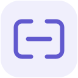
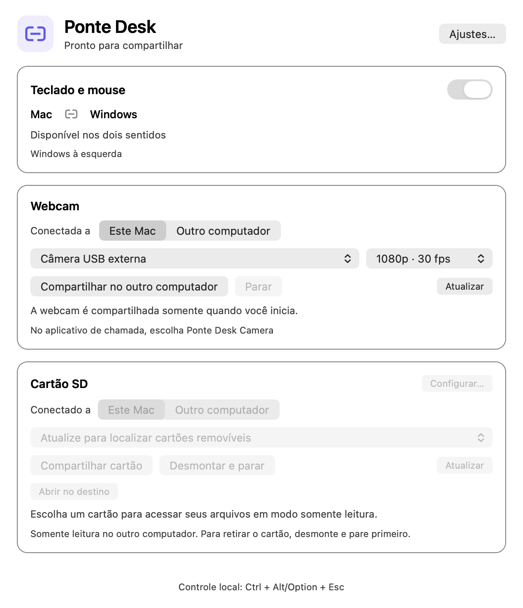

<p align="center"></p>
<h1 align="center">Ponte Desk</h1>
<p align="center">Seus computadores, juntos.</p>

Um aplicativo gratuito e aberto para compartilhar teclado, mouse, webcam externa e cartão SD entre um Mac e um computador Windows na mesma rede. Interface nativa, uso manual da câmera e recursos que você pode ativar conforme sua rotina.

<picture>
  <source media="(prefers-color-scheme: dark)" srcset="assets/ponte-desk-dark.png">
  
</picture>

## Escolha o que compartilhar

- **Teclado e mouse:** atravesse a borda entre as telas para controlar o outro computador. Escolha se ele fica à esquerda, à direita, acima ou abaixo.
- **Webcam externa:** deixe o USB em qualquer um dos computadores e compartilhe quando precisar. Captura em 1080p/30 ou 720p/30 para reduzir o tráfego. A câmera começa desligada.
- **Cartão SD:** publique uma mídia removível em somente leitura e monte no outro computador pelo Finder ou Explorer. Sem copiar o cartão inteiro antes. [Configuração e limites](docs/storage.md).
- **Monitor compartilhado, opcional:** para quem alterna a entrada de um mesmo monitor entre os computadores. A configuração identifica o monitor e suas entradas; a automação pode reorganizar as telas do Mac e restaurá-las depois.
- **Proteção de tela cheia:** opções separadas para pausar o compartilhamento durante tela cheia no Windows e impedir a saída do cursor durante tela cheia no Mac.

O modo padrão usa **telas independentes**. Não exige monitor específico, DDC ou calibração. O monitor compartilhado começa desativado e só pode ser ligado após a configuração.

## Como funciona

O painel fica na barra de menus do Mac e na bandeja do Windows, com o mesmo símbolo e os mesmos recursos. Os dois aplicativos permitem pausar/retomar teclado e mouse, controlar webcam e cartão SD, e editar os ajustes compartilhados. Fechar a janela mantém o aplicativo na barra; use Encerrar Ponte Desk no menu para finalizar. Sem conta, nuvem, NAS ou assinatura, e sem precisar manter outro aplicativo aberto. A webcam física só é capturada após o início manual do compartilhamento.

No aplicativo de chamada, escolha **Ponte Desk Camera**. No Mac, o componente assinado publica uma saída 1080p; a opção 720p reduz captura e rede, e o receptor adapta a imagem. O microfone continua sendo o escolhido localmente no aplicativo de chamada.

## Requisitos

- macOS 14 ou posterior e Windows 11.
- Mesma rede local; conexão por cabo é recomendada para vídeo.
- Webcam USB externa para compartilhar câmera. Não há substituição automática pela câmera integrada.
- Pareamento configurado nos dois lados. Esta versão oferece um par Mac–Windows; há um aplicativo instalado em cada máquina.

## Compilar e instalar

A versão inicial para publicação é voltada a quem aceita compilar e configurar o pareamento. Ela ainda não tem um assistente de descoberta e pareamento automático.

No Mac, instale Rust estável e as ferramentas de linha de comando do Xcode:

```sh
./scripts/build-macos.sh
```

O aplicativo é criado em `dist/Ponte Desk.app`. A assinatura local do aplicativo é ad hoc; o componente de câmera mantém a assinatura notarizada de seu fornecedor. Compilar não ativa extensões nem concede permissões.

No Windows, use Rust com MSVC ou GNU/MinGW:

```powershell
cargo build --release --no-default-features
./native/windows/webcam/build.ps1
./native/windows/storage/build.ps1
./native/windows/app/build.ps1
```

A interface Windows usa WinForms e o .NET Framework incluído no Windows 11, sem WebView ou outro aplicativo residente. A DLL de câmera requer MSVC x64 e Windows SDK 26100. Veja [instalação e pareamento](docs/setup.md), [opções](docs/options.md) e [componente da câmera](docs/camera-component.md). Depois do pareamento, o instalador `scripts/install-windows.ps1` registra a DLL uma vez e inicia o serviço em usuário comum.

**Use a mesma versão nos dois computadores.** O controle dos ajustes pelos dois lados exige a versão 0.5. O armazenamento requer a versão 0.4 ou posterior nos dois lados. A versão 0.3 introduz opções autenticadas no protocolo de coordenação; atualize o par junto.

## Ajustes

Abra **Ajustes…** no painel ou no menu da barra. Os recursos podem ser configurados separadamente. Para monitor compartilhado, selecione o monitor nos dois sistemas, mude fisicamente para cada entrada e clique no botão correspondente para identificá-la. O aplicativo observa a entrada; não muda a entrada física por você.

A reorganização automática exige uma tela integrada ativa no Mac. Em computadores sem essa tela, o compartilhamento de teclado/mouse continua disponível; a desativação automática de saída não é oferecida. Se a identificação do monitor falhar, esse modo mantém o controle local.

## Automação e controle local

Automações que operam o desktop devem usar o isolamento cooperativo:

```sh
ponte-desk agent begin --owner agent --ttl 180
ponte-desk agent renew TOKEN --ttl 180
ponte-desk agent end TOKEN
```

Guarde o token, opere somente após sucesso, renove a cada 60 segundos e finalize mesmo em erro. Não remova o isolamento de outra sessão. Eventos sintéticos comuns também são filtrados; HID virtual depende desse isolamento explícito. Há um cursor por sessão de desktop: não são dois cursores independentes no mesmo computador.

O atalho padrão para recuperar controle local é **Ctrl + Alt/Option + Esc**.

## Desenvolvimento

```sh
cargo test --no-default-features -p ponte-desk -p input-capture -p input-emulation
cargo clippy --no-default-features --all-targets -- -D warnings -A clippy::double_must_use
cargo fmt --all -- --check
python3 tests/coordinator_smoke.py target/release/ponte-desk
```

O smoke test usa backends dummy e estado autenticado de loopback, sem enviar entrada real. O diagnóstico `examples/kvm_link_probe.rs` testa o transporte pareado com Ping/Pong, sem teclas, cliques ou movimento. [Arquitetura](docs/architecture.md) · [Validação](docs/validation.md) · [Contribuir](CONTRIBUTING.md).

## Créditos e licença

Ponte Desk deriva do código do Lan Mouse e preserva seus autores, licença e histórico upstream. Componentes reutilizados mantêm os avisos e as licenças correspondentes. [Licença](LICENSE) · [Créditos](NOTICE) · [Documentação upstream](README-UPSTREAM.md).
